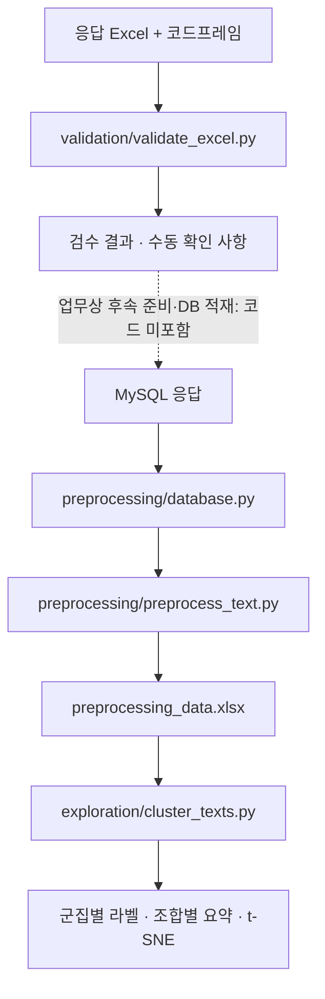

# 리서치 정성 데이터의 검수·전처리·군집 탐색

리서치 주관식 답변을 자동으로 라벨링하려면, 프로젝트마다 다른 데이터 형식과 라벨 체계를 먼저 정리해야 한다. 이 저장소는 코리아리서치인터내셔널의 AI 기반 리서치 정성 데이터 분석 플랫폼 구축 업무에서 작성한 검수·전처리·유사 문서 탐색 코드를 담고 있다.

## 프로젝트 배경과 담당 업무

프로젝트 전체의 목표는 주관식 답변의 토픽·감성을 자동으로 라벨링하는 AI와 내부 플랫폼을 구축하는 것이었다. 코리아리서치인터내셔널은 AI바우처 사업의 수요기업으로 참여했고, 공급기업 애자일소다가 AI 모델 개발·학습을 담당했다.

본인은 수요기업 측 실무자로서 학습 대상 도메인·프로젝트 선정, 분산된 Excel 데이터의 수집·검수, 도메인별 라벨 체계 표준화와 기존 데이터 재적용을 주도했다. Python 업무 자동화와 DB·Power BI 기반 데이터 준비 현황 관리, 아르바이트 인력 3명의 작업·교육·검수·일정·정산 실무, 공급기업 및 사내 실무진과의 조율도 담당했다.

본인의 담당 데이터 준비 업무를 완료한 뒤 플랫폼화가 진행되는 과정에서 퇴사했으며, 전체 플랫폼의 개발·배포 완료 여부와 이후 운영 성과는 이 저장소에서 확인할 수 없다.

## 코드가 맡는 역할

| 기능 | 업무에서의 용도 | 현재 구현 범위 |
| --- | --- | --- |
| Excel 검수 | 수집한 응답과 코드프레임의 정합성 확인 | 제품·문항 대응, 중복 코드, Sub-Net 값과 코드 존재 여부, Net 누락, 무응답 범주의 수동 확인 |
| 텍스트 전처리 | 유사 문서 탐색에 사용할 응답 준비 | MySQL 응답 조회, 문자 정리, 띄어쓰기·맞춤법 보정, 명사 추출, Excel 저장 |
| 군집 탐색 | 통합 라벨 체계를 검토할 때 유사한 답변 묶음 탐색 | TF-IDF, DBSCAN 파라미터 조합 비교, t-SNE 시각화 |

업무 순서는 본인의 기억을 기준으로 **검수 → 데이터 전처리 → 군집 탐색**이다. 전처리 결과 Excel은 군집 탐색의 입력으로 연결된다. 검수한 자료를 MySQL에 적재하는 과정은 현재 코드에 포함되어 있지 않다.

라벨 체계를 실제 데이터에 재적용하는 전체 과정, 데이터 관리 대시보드, 공급기업의 자동 라벨링 모델, 플랫폼 API·화면은 이 저장소의 구현 범위에 포함되지 않는다. 현재 제공하는 함수 분리·입력 검사·오류 처리·테스트는 코드 정제의 결과이며, 그 구성을 그대로 당시 업무 구현이나 성과로 소급하지 않는다.

## 구조와 처리 흐름



각 단계는 독립적으로 실행할 수 있다. 모듈을 import하는 것만으로 파일 읽기·저장, DB 조회, NLP 모형 초기화 또는 그래프 표시가 시작되지는 않는다.

검수 입력은 첫 열 제목이 제품명이고, 나머지 열 제목이 문항명인 Excel이다. 그 아래 첫 행은 `text`, `subnet` 등의 세부 항목이며, 같은 문항이 여러 열에 반복될 수 있다. 코드프레임에는 `제품`, `문항`, `코드`, `Net`, `Sub-Net` 열이 필요하다. 실제 양식과의 재대조는 필요하며, 현재 형식은 본인의 기억과 기존 코드에 근거한다.

## 최소 사용법

프로젝트 폴더에서 별도 Python 환경을 만들고 필요한 기능의 의존성을 설치한다. 아래는 Windows PowerShell 예시다.

```powershell
python -m venv .venv
.\.venv\Scripts\python.exe -X utf8 -m pip install -r requirements-exploration.txt -c requirements-tested.txt
.\.venv\Scripts\python.exe -X utf8 -m validation.validate_excel "응답.xlsx" "코드프레임.xlsx"
.\.venv\Scripts\python.exe -X utf8 -m exploration.cluster_texts "preprocessing_data.xlsx" --no-plot
```

검수만 사용하면 `requirements-validation.txt`를 설치하면 된다. 군집 그래프도 보려면 `--no-plot`을 제외한다. 표본 수가 작으면 `--perplexity`를 응답 수보다 작은 양수로 지정해야 한다. 전체 문서 간 거리 행렬을 만들기 때문에 문서 수가 커질수록 메모리 사용량이 제곱으로 증가한다.

전처리는 `requirements-preprocessing.txt` 외에 PyKoSpacing, hanspell, KoNLPy와 관련 모형·Java 환경이 필요하다. 이 추가 환경은 현재 검증한 의존성 목록에 포함되어 있지 않다. `MYSQL_HOST`, `MYSQL_USER`, `MYSQL_PASSWORD`, `MYSQL_DATABASE` 환경변수를 설정하고 필요하면 `MYSQL_PORT`를 지정한다. 비밀값을 소스 파일에 넣지 않는다.

```powershell
.\.venv\Scripts\python.exe -X utf8 -m preprocessing.preprocess_text --table food_project --output preprocessing_data.xlsx --allow-external-spellcheck
```

이 명령은 실제 MySQL을 조회하고, 응답을 외부 맞춤법 검사 서비스에 보내며, 결과 Excel을 저장한다. 외부 전송이 허용된 데이터와 준비된 NLP 환경에서만 실행한다. 기존 출력 파일은 `--overwrite`를 지정한 경우에만 덮어쓴다. 검수와 군집 탐색은 원본 Excel을 저장·수정하지 않으며, 군집 명령은 응답 원문 대신 조합별 요약을 출력한다.

실행 조건과 예제 검증·실제 환경 검증의 구분은 [검증 기록](docs/validation.md)에 정리했다.


